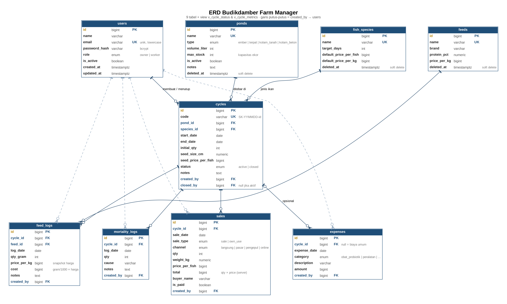

# Budikdamber Farm Manager

REST API untuk mengelola usaha budidaya ikan rumahan dengan sistem **budikdamber** (budidaya ikan dalam ember) dan kolam terpal: mencatat siklus tebar, pemberian pakan, kematian, penjualan, dan pengeluaran, lalu menghitung **survival rate, HPP per ekor, laba, dan margin** secara otomatis.

Dibuat sebagai Final Project Bootcamp Golang SanberCode, berdasarkan kebutuhan usaha budidaya lele milik penulis sendiri.

- **Production:** https://budikdamber-farm-manager-production.up.railway.app
- **Swagger (dokumentasi interaktif):** https://budikdamber-farm-manager-production.up.railway.app/swagger/index.html
- **Health check:** https://budikdamber-farm-manager-production.up.railway.app/health

---

## Daftar Isi

- [Masalah yang Diselesaikan](#masalah-yang-diselesaikan)
- [Fitur](#fitur)
- [Tech Stack](#tech-stack)
- [Arsitektur](#arsitektur)
- [Skema Database](#skema-database)
- [Aturan Bisnis](#aturan-bisnis)
- [Autentikasi & Role](#autentikasi--role)
- [Daftar Endpoint](#daftar-endpoint)
- [Format Response](#format-response)
- [Cara Pakai (Alur Demo)](#cara-pakai-alur-demo)
- [Menjalankan di Lokal](#menjalankan-di-lokal)
- [Deployment](#deployment)
- [Keputusan Desain](#keputusan-desain)
- [Keterbatasan & Pengembangan Berikutnya](#keterbatasan--pengembangan-berikutnya)

---

## Masalah yang Diselesaikan

Pembudidaya skala rumahan biasanya mencatat di buku atau tidak mencatat sama sekali, sehingga sulit menjawab pertanyaan sederhana:

- Berapa ikan yang **masih hidup** di tiap ember/kolam?
- Berapa **modal per ekor** (HPP) dan apakah harga jual sudah untung?
- Siklus mana yang **rugi**, dan karena apa (banyak mati? pakan boros?)
- Siapa pembeli yang **belum bayar**?

Aplikasi ini mencatat semua kejadian harian per **siklus** (satu periode tebar sampai panen) dan menghitung angka-angka tersebut langsung dari data.

## Fitur

| Modul | Fitur |
|---|---|
| **Auth** | Login JWT, register mandiri (akun baru menunggu aktivasi owner), profil user login |
| **User** | Kelola user oleh owner, aktif/nonaktifkan akun, proteksi akun sendiri |
| **Data master** | CRUD wadah (ember/terpal/kolam), jenis ikan, pakan — dengan soft delete |
| **Siklus** | Buat siklus dengan **cek kapasitas wadah**, kode otomatis `SK-YYMMDD-id`, tutup & buka kembali siklus |
| **Log pakan** | Catat pemberian pakan, biaya dihitung otomatis dengan **snapshot harga** pakan saat itu |
| **Log kematian** | Catat ikan mati, siklus **otomatis ditutup** jika ikan hidup habis |
| **Penjualan** | Jual per ekor via kanal (langsung/pasar/pengepul/online), konsumsi sendiri, status lunas/piutang |
| **Pengeluaran** | Biaya per siklus maupun biaya umum (obat/probiotik, peralatan, utilitas, tenaga kerja) |
| **Metrik siklus** | SR, total biaya, pendapatan, piutang, laba, **HPP per ekor**, margin |
| **Dashboard** | Stok & kapasitas, keuangan, penjualan & margin per kanal, daftar piutang, siklus mendekati panen |

## Tech Stack

| Bagian | Teknologi |
|---|---|
| Bahasa | Go 1.27 |
| Web framework | Gin |
| Database | PostgreSQL 16 (driver `pgx/v5`, tanpa ORM) |
| Migrasi | golang-migrate (sequential up/down) |
| Auth | JWT (`golang-jwt/jwt/v5`, HS256) + bcrypt |
| Validasi | go-playground/validator (via Gin binding) |
| Dokumentasi | Swagger (swaggo) |
| Konkurensi | `golang.org/x/sync/errgroup` (query dashboard paralel) |
| Lokal | Docker Compose (PostgreSQL), Makefile |
| Production | Railway (aplikasi, build dari Dockerfile) + Neon (PostgreSQL, region Singapore) |

## Arsitektur

**Layered Architecture** (Handler → Service → Repository) dengan **Repository Pattern** dan dependency injection lewat constructor.

```
HTTP request
   │
   ▼
Middleware     AuthRequired (JWT + cek status/role ke DB) → RequireRoles (RBAC)
   │
   ▼
Handler        internal/handler     baca request, validasi format, kirim response
   │
   ▼
Service        internal/service     aturan bisnis (tanggal, default nilai, own_use gratis, dst.)
   │
   ▼
Repository     internal/repository  SQL, transaksi, row lock (SELECT ... FOR UPDATE)
   │
   ▼
PostgreSQL     constraint, foreign key, trigger, view metrik
```

Struktur folder:

```
cmd/
  main.go            entry point server (graceful shutdown)
  seed/              seeder akun owner
  seed-demo/         seeder data demo
internal/
  auth/              JWT manager
  config/            baca konfigurasi dari environment
  database/          koneksi pgxpool
  handler/           HTTP handler + anotasi Swagger
  middleware/        auth, RBAC
  model/             struct entity, input, filter
  repository/        akses database
  response/          format response standar
  router/            wiring dependency & routing
  service/           aturan bisnis
migrations/          file SQL migrasi (000001 – 000015)
docs/swagger/        hasil generate Swagger
```

## Skema Database

9 tabel + 2 view. Semua uang disimpan sebagai `BIGINT` (rupiah, tanpa desimal).



| Tabel | Isi | Relasi |
|---|---|---|
| `users` | Akun owner & worker | Dirujuk oleh `created_by` di 5 tabel transaksi |
| `ponds` | Wadah: ember, terpal, kolam | 1 → N `cycles` |
| `fish_species` | Jenis ikan, target hari panen, harga default | 1 → N `cycles` |
| `feeds` | Jenis pakan & harga per kg | 1 → N `feed_logs` |
| `cycles` | Satu periode tebar sampai panen | N → 1 ponds, fish_species, users |
| `feed_logs` | Pemberian pakan harian | N → 1 cycles, feeds, users |
| `mortality_logs` | Ikan mati | N → 1 cycles, users |
| `sales` | Penjualan & konsumsi sendiri | N → 1 cycles, users |
| `expenses` | Pengeluaran (per siklus atau umum) | N → 0..1 cycles, N → 1 users |

| View | Isi |
|---|---|
| `v_cycle_status` | `initial_qty`, `dead_qty`, `sold_qty`, `alive_qty` per siklus |
| `v_cycle_metrics` | Biaya bibit/pakan/lain, pendapatan, piutang, laba, SR, HPP, margin per siklus |

## Aturan Bisnis

| Kode | Aturan | Dijaga di |
|---|---|---|
| R01 | Jumlah ikan hidup di satu wadah tidak boleh melebihi `max_stock` | Repository (row lock wadah) |
| R02 | Jumlah mati/terjual tidak boleh melebihi ikan hidup | Repository (row lock siklus) |
| R03 | Biaya pakan = gram ÷ 1000 × harga/kg, harga **disalin** saat dicatat | Repository + kolom `price_per_kg` |
| R04 | Siklus tertutup bersifat read-only (kecuali tandai lunas) | Repository |
| R05 | Siklus otomatis ditutup saat ikan hidup = 0 | Repository (log kematian & penjualan) |
| R06 | Total penjualan dihitung server: `qty × price_per_fish` | Service + CHECK constraint |
| R07 | Konsumsi sendiri (`own_use`) selalu gratis dan tanpa kanal | Service + CHECK constraint |

Rumus metrik:

| Metrik | Rumus |
|---|---|
| Survival rate | (awal − mati) ÷ awal × 100% |
| Total biaya | bibit + pakan + pengeluaran siklus |
| HPP per ekor | total biaya ÷ (awal − mati) |
| Laba | pendapatan − total biaya |
| Margin | laba ÷ pendapatan × 100% |

Selama siklus masih aktif, metrik bersifat sementara (`is_final: false`).

## Autentikasi & Role

1. Login di `POST /api/users/login` (atau `/api/v1/users/login`) → mendapat token JWT (berlaku 24 jam).
2. Kirim token di header: `Authorization: Bearer <token>`.
3. Di setiap request, middleware memverifikasi token **dan** membaca status & role terbaru dari database — user yang dinonaktifkan atau diturunkan role-nya langsung kehilangan akses tanpa menunggu token kedaluwarsa.

| Role | Hak akses |
|---|---|
| **owner** | Semua fitur, termasuk data master, user, metrik keuangan, dashboard |
| **worker** | Melihat data, mencatat pakan, kematian, dan penjualan. Tidak bisa mengubah data master, user, pengeluaran, atau melihat metrik keuangan |

**Register:** akun hasil register selalu menjadi `worker` dengan status **nonaktif**, dan baru bisa login setelah diaktifkan owner (`PATCH /users/:id/status`). Field `role` di body register diabaikan.

**Akun demo (production):**

| Role | Email |
|---|---|
| Owner | `owner@budikdamber.local` |
| Worker | `pekerja@budikdamber.local` |

Password dibagikan terpisah kepada trainer.

## Daftar Endpoint

Base URL: `/api/v1` (kecuali disebutkan lain). Detail body & response ada di Swagger.

### Publik

| Method | Path | Keterangan |
|---|---|---|
| GET | `/health` | Status aplikasi & database |
| GET | `/swagger/index.html` | Dokumentasi Swagger |
| POST | `/api/users/login` | Login (path sesuai ketentuan final project) |
| POST | `/api/users/register` | Register |
| POST | `/api/v1/users/login` | Login |
| POST | `/api/v1/users/register` | Register (akun nonaktif, menunggu owner) |

### Auth & User

| Method | Path | Role | Keterangan |
|---|---|---|---|
| GET | `/auth/me` | semua | Profil user yang sedang login |
| GET | `/users` | owner | Daftar user (filter `search`, paginasi) |
| GET | `/users/:id` | owner | Detail user |
| POST | `/users` | owner | Buat user (owner/worker), langsung aktif |
| PUT | `/users/:id` | owner | Ubah user, termasuk reset password |
| PATCH | `/users/:id/status` | owner | Aktif/nonaktifkan user |

### Data Master

| Method | Path | Role |
|---|---|---|
| GET | `/ponds`, `/ponds/:id` | semua |
| POST · PUT · DELETE | `/ponds`, `/ponds/:id` | owner |
| GET | `/fish-species`, `/fish-species/:id` | semua |
| POST · PUT · DELETE | `/fish-species`, `/fish-species/:id` | owner |
| GET | `/feeds`, `/feeds/:id` | semua |
| POST · PUT · DELETE | `/feeds`, `/feeds/:id` | owner |

DELETE bersifat soft delete. Filter list: `search`, `page`, `limit` (wadah juga `type`, `is_active`).

### Siklus

| Method | Path | Role | Keterangan |
|---|---|---|---|
| GET | `/cycles` | semua | Filter `status`, `pond_id`, `species_id` |
| GET | `/cycles/:id` | semua | Detail + jumlah hidup/mati/terjual + umur siklus |
| POST | `/cycles` | owner | Buat siklus (cek kapasitas wadah) |
| POST | `/cycles/:id/close` | owner | Tutup manual (`end_date` opsional, default hari ini) |
| POST | `/cycles/:id/reopen` | owner | Buka kembali (cek ulang kapasitas) |
| GET | `/cycles/:id/metrics` | owner | SR, biaya, pendapatan, laba, HPP, margin |

### Log Harian & Penjualan

| Method | Path | Role | Keterangan |
|---|---|---|---|
| GET | `/cycles/:id/feed-logs` | semua | Filter `date_from`, `date_to` |
| POST | `/cycles/:id/feed-logs` | semua | Catat pakan |
| DELETE | `/feed-logs/:id` | owner | Hapus log (hanya siklus aktif) |
| GET | `/cycles/:id/mortality-logs` | semua | Filter tanggal |
| POST | `/cycles/:id/mortality-logs` | semua | Catat ikan mati (auto-close jika habis) |
| DELETE | `/mortality-logs/:id` | owner | Hapus log (hanya siklus aktif) |
| GET | `/cycles/:id/sales` | semua | Filter tanggal, `sale_type`, `is_paid` |
| POST | `/cycles/:id/sales` | semua | Catat penjualan / konsumsi sendiri |
| PATCH | `/sales/:id/paid` | owner | Tandai lunas / belum (boleh setelah siklus ditutup) |
| DELETE | `/sales/:id` | owner | Hapus penjualan (hanya siklus aktif) |

### Pengeluaran & Dashboard

| Method | Path | Role | Keterangan |
|---|---|---|---|
| GET | `/expenses`, `/expenses/:id` | semua | Filter `cycle_id`, `general_only`, `category`, tanggal |
| POST · PUT · DELETE | `/expenses`, `/expenses/:id` | owner | Kategori: `obat_probiotik`, `peralatan`, `utilitas`, `tenaga_kerja`, `lainnya` |
| GET | `/dashboard` | owner | Ringkasan usaha; filter `date_from`, `date_to` untuk penjualan per kanal |

## Format Response

Semua endpoint memakai format yang sama:

```json
{
  "success": true,
  "message": "berhasil mengambil daftar wadah",
  "data": [ ... ],
  "meta": { "page": 1, "limit": 10, "total": 3, "total_pages": 1 }
}
```

Error validasi menyertakan detail per field:

```json
{
  "success": false,
  "message": "validasi gagal",
  "errors": { "start_date": "format tanggal harus YYYY-MM-DD" }
}
```

| Status | Arti |
|---|---|
| 400 | Input tidak valid / melanggar aturan bisnis |
| 401 | Token tidak ada, tidak valid, kedaluwarsa, atau akun nonaktif |
| 403 | Role tidak punya akses, atau akun belum diaktifkan (saat login) |
| 404 | Data tidak ditemukan |
| 409 | Konflik: nama/email sudah dipakai, kapasitas penuh, melebihi ikan hidup, siklus sudah ditutup |
| 500 | Kesalahan server |

## Cara Pakai (Alur Demo)

Contoh dengan `curl` ke production. Ganti `BASE` untuk lokal (`http://localhost:8080`).

```bash
BASE=https://budikdamber-farm-manager-production.up.railway.app

# 1. Login owner → simpan token
TOKEN=$(curl -s -X POST $BASE/api/users/login -H 'Content-Type: application/json' \
  -d '{"email":"owner@budikdamber.local","password":"<password>"}' | jq -r '.data.token')

# 2. Lihat dashboard
curl -s $BASE/api/v1/dashboard -H "Authorization: Bearer $TOKEN" | jq '.data'

# 3. Buat siklus baru: 45 ekor lele di wadah id 1
curl -s -X POST $BASE/api/v1/cycles -H "Authorization: Bearer $TOKEN" -H 'Content-Type: application/json' \
  -d '{"pond_id":1,"species_id":1,"start_date":"2026-10-19","initial_qty":45,"seed_price_per_fish":500}' | jq

# 4. Catat pakan 100 gram
curl -s -X POST $BASE/api/v1/cycles/<id>/feed-logs -H "Authorization: Bearer $TOKEN" -H 'Content-Type: application/json' \
  -d '{"feed_id":1,"log_date":"2026-10-19","qty_gram":100}' | jq

# 5. Jual 10 ekor ke pasar (harga default jenis ikan)
curl -s -X POST $BASE/api/v1/cycles/<id>/sales -H "Authorization: Bearer $TOKEN" -H 'Content-Type: application/json' \
  -d '{"sale_date":"2026-10-19","channel":"pasar","qty":10}' | jq

# 6. Lihat metrik siklus
curl -s $BASE/api/v1/cycles/<id>/metrics -H "Authorization: Bearer $TOKEN" | jq '.data'
```

Atau lebih mudah lewat **Swagger**: klik **Authorize**, isi `Bearer <token>`, lalu coba endpoint satu per satu.

## Menjalankan di Lokal

**Prasyarat:** Go 1.27, Docker Desktop, [golang-migrate CLI](https://github.com/golang-migrate/migrate), `make`, `jq` (opsional).

```bash
# 1. Clone & siapkan environment
git clone https://github.com/AgungRilo/budikdamber-farm-manager.git
cd budikdamber-farm-manager
cp .env.example .env          # isi JWT_SECRET (≥ 32 karakter) & password seeder

# 2. Jalankan PostgreSQL (Docker, port 5433)
make docker-up

# 3. Migrasi + akun owner + data demo
make migrate-up
make seed
make seed-demo

# 4. Jalankan server
make run                      # http://localhost:8080/swagger/index.html
```

Variabel environment (`.env`):

| Variabel | Keterangan |
|---|---|
| `DATABASE_URL` | Koneksi PostgreSQL lokal |
| `PORT` | Port server (default 8080) |
| `APP_ENV` | `development` / `production` |
| `JWT_SECRET` | Rahasia penandatangan JWT, minimal 32 karakter |
| `JWT_EXPIRES_IN` | Masa berlaku token, contoh `24h` |
| `SEED_OWNER_NAME`, `SEED_OWNER_EMAIL`, `SEED_OWNER_PASSWORD` | Akun owner dari seeder |
| `SEED_WORKER_PASSWORD` | Password akun worker demo |

Perintah Makefile yang sering dipakai:

| Perintah | Fungsi |
|---|---|
| `make run` | Jalankan server |
| `make test` | Jalankan unit test |
| `make swag` | Generate ulang dokumentasi Swagger |
| `make migrate-up` / `migrate-down` | Naik / turun 1 versi migrasi |
| `make migrate-create name=xxx` | Buat file migrasi baru |
| `make seed` / `seed-demo` | Buat akun owner / data demo |
| `make db-reset` | Kosongkan & isi ulang DB **lokal** |

## Deployment

```
GitHub (main) ──push──▶ Railway (build Dockerfile, region Southeast Asia) ──▶ Neon PostgreSQL (Singapore)
```

- Aplikasi dibangun dengan **Dockerfile multi-stage** (binary statis di image Alpine).
- Konfigurasi production lewat environment variable di Railway (`DATABASE_URL`, `JWT_SECRET`, `APP_ENV=production`, dst.).
- Migrasi production dijalankan dari lokal: `make migrate-up-prod`.

## Keputusan Desain

- **Tanpa ORM (pgx + SQL langsung):** transaksi, `SELECT ... FOR UPDATE`, view, dan query agregasi lebih mudah dikendalikan dan dibaca.
- **Row lock untuk konsistensi:** pembuatan siklus mengunci baris wadah; log kematian & penjualan mengunci baris siklus — dua request bersamaan tidak bisa sama-sama lolos cek kapasitas / sisa ikan.
- **Aturan dijaga dua lapis:** di Go *dan* di database (CHECK, FK, unique index), misalnya `total = qty × price_per_fish`.
- **Snapshot harga pakan:** biaya historis tidak berubah ketika harga pakan naik.
- **Log tidak bisa diedit, hanya tambah/hapus:** jejak catatan harian lebih jelas.
- **Soft delete** pada data master agar data historis siklus tetap utuh.
- **Tanggal "hari ini" memakai WIB**, bukan zona waktu server (Railway/Neon memakai UTC).
- **Dashboard memakai goroutine (errgroup):** 5 query independen dijalankan paralel; tiap goroutine menulis ke field berbeda sehingga bebas data race.
- **Pengeluaran tidak punya kategori pakan/bibit:** keduanya sudah tercatat di log pakan & siklus, sehingga HPP tidak terhitung dobel.

## Keterbatasan & Pengembangan Berikutnya

- Logout berbasis server (token revocation) belum ada; token kedaluwarsa dalam 24 jam, dan akun nonaktif langsung ditolak.
- Belum ada fitur ganti password mandiri & lupa password via email (reset dilakukan owner).
- Notifikasi pengingat (pakan, piutang, jadwal panen) via penjadwal + bot Telegram.
- Log kualitas air & sampling pertumbuhan untuk menghitung FCR.
- Unit test layer service dengan interface repository.

---

Dibuat oleh **Agung Rilo Pambudi** — Final Project Bootcamp Golang SanberCode, Oktober 2026.
